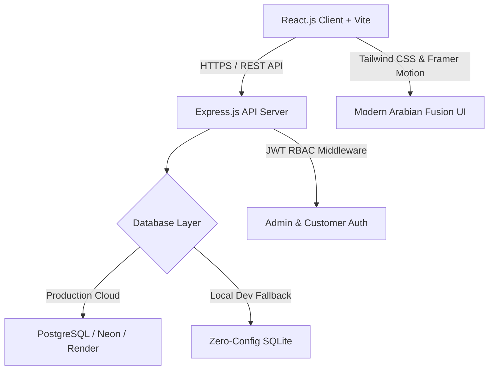

# OUDÉ – Arabian Luxury Perfumes
### *The Essence of Arabian Luxury*
**Full-Stack E-Commerce Web Application & UX Reimagination**

* **Candidate:** Hani Nazer Mutheri
* **Assessment:** AHP Full Stack Developer Practical Task
* **Inspiration Reference:** `alhajisperfumes.com` (Evaluated for UX improvements, brand identity reimagined from scratch)
* **Industry:** Beauty, Fragrance & Luxury Perfumes
* **Currency:** Indian Rupee (INR – ₹)
* **Design Theme:** Modern Arabian Fusion / Arabian Desert Luxury

---

## 🌟 Executive Summary & Project Overview

**OUDÉ** is a modern luxury perfume e-commerce platform inspired by the grandeur and heritage of Arabian perfumery. Designed from the ground up to solve the user experience deficiencies common to legacy perfume storefronts (such as `alhajisperfumes.com`), OUDÉ delivers an immersive digital olfactory experience featuring:

* **Seven Original Signature Arabian Fragrances** (100ml Eau de Parfum Extraits).
* **Interactive 3-Tier Olfactory Notes Pyramid** (Top, Heart, and Base notes with evolutionary longevity timers).
* **Interactive Scent Profiler Diagnostic Quiz** matching customers to their signature fragrance in 60 seconds.
* **Persistent User Carts & Server-Side Total Calculation** with live stock validation and out-of-stock guardrails.
* **Streamlined Single-Page Luxury Checkout** with simulated payment gateways (Card, UPI, COD) and instant verifiable order confirmation.
* **Full-Featured Executive Admin Control Suite** protected by backend-enforced Role-Based Access Control (RBAC).
* **Dual Database Architecture:** Native PostgreSQL production support (Neon / Render) with an automatic zero-config fallback to SQLite for local development.

---

## 🏆 Key UX Improvements Over `alhajisperfumes.com`

As required by the practical task guidelines, here is the detailed breakdown of the **4 core UX improvements** introduced in OUDÉ and the user-centric rationale behind each design decision:

### 1. Interactive Olfactory Notes Pyramid & Sensory Diagnostics
* **Problem on Reference Site (`alhajisperfumes.com`):** Fragrance notes on traditional perfume websites are buried in unstructured walls of plain text or omitted entirely. Perfume shoppers cannot visualize how an Arabian fragrance evolves over time, resulting in high return rates and hesitation.
* **OUDÉ Solution & Why:** OUDÉ features an interactive 3-tier **Fragrance Pyramid** (Top Notes: 15–30 mins opening; Heart Notes: 2–6 hours soul; Base Notes: 8–16+ hours sillage drydown). Users can tap each tier to explore individual note badges (Saffron, Cambodian Oud, Rose, Amber) and read about the scent's trajectory. Additionally, the **Scent Profiler Diagnostic Quiz** guides undecided customers through 3 sensory questions to uncover their signature scent without feeling overwhelmed.

### 2. Persistent Slide-Out Cart Drawer with Server-Side Validation & Shipping Meter
* **Problem on Reference Site:** Customers are forcefully redirected to a separate, clunky cart page whenever an item is added. Cart totals are often client-calculated or vulnerable to out-of-stock checkout failures.
* **OUDÉ Solution & Why:** OUDÉ introduces a smooth, non-intrusive slide-out cart drawer powered by Framer Motion. The drawer features a **Complimentary Delivery Progress Bar** (e.g., *"Add ₹501 more to unlock complimentary white-glove delivery across India"*), dynamic quantity steppers, instant promo code evaluation (`OUDE10`), and real-time server-side stock validation that gracefully flags low or exhausted inventory before the user reaches checkout. Guest carts persist in local storage and seamlessly sync into the database upon user login.

### 3. Streamlined One-Page Accordion Checkout with Instant Visual Confirmation
* **Problem on Reference Site:** Multi-step checkouts with slow page reloads cause high cart abandonment. Post-purchase confirmation is often a plain text notice without receipt details or tracking transparency.
* **OUDÉ Solution & Why:** OUDÉ condenses checkout into an intuitive, single-page flow with auto-filled registered profile data, simulated payment options (Cards, UPI, COD), and server-side atomic inventory deductions. Upon placement, customers are greeted with a confetti celebration and a luxury receipt displaying an official tracking ID (`OUDE-2026-XXXXX`), itemized costs, delivery timeline, and a 1-click **"Print Official Invoice"** feature.

### 4. Haute Parfumerie Aesthetic, Bespoke Studio Flacons & Micro-Animations
* **Problem on Reference Site:** Generic e-commerce templates with jarring color clashes, cramped product grids, generic stock perfume bottles (Chanel/Dior bottles placed as placeholders), and a complete lack of luxury atmosphere.
* **OUDÉ Solution & Why:** Designed with an **Imperial Obsidian Black & 24K Liquid Gold Haute Parfumerie** design system inspired by Xerjoff and Amouage:
  * **Bespoke Arabian Studio Flacon Photography:** All 7 perfumes feature custom-crafted, photorealistic Arabian flacons resting on black marble with intricate Islamic arabesque filigree and jewel-cut caps.
  * **Editorial Masked Line-by-Line Typography Entrance Animation:** On page mount, each line of `THE ESSENCE OF ARABIAN LUXURY.` gracefully reveals from an overflow mask with high-fashion easing.
  * **Hero Perfume Royal Levitation & Ambient Sunset Golden Aura:** The hero flacon gently floats with a synchronized ground plinth shadow and an ethereal sunset golden backlight pulsing behind the bottle.
  * **Vitrine Cards with Radial Halos:** Product cards function as museum vitrines with ambient radial glows, 28% Extrait badges, and embossed 24K gold buttons (`.btn-gold-embossed`).

---

## 🌹 The Seven OUDÉ Original Perfumes Catalogue

| No. | Product Name | Fragrance Category | Price (INR) | Size | Bottle Colour | Fragrance Character | Key Notes |
|:---:|:---|:---|:---:|:---:|:---|:---|:---|
| **1** | **Oud Royal** | Oriental Woody | ₹4,999 | 100ml | Amber Gold | Rich, luxurious and warm | **Top:** Saffron, Cardamom, Bergamot<br>**Heart:** Rose, Oud, Incense<br>**Base:** Amber, Sandalwood, Musk |
| **2** | **Desert Bloom** | Floral Oriental | ₹3,499 | 100ml | Rose Pink | Floral, elegant and feminine | **Top:** Bergamot, Pink Pepper, Mandarin<br>**Heart:** Damask Rose, Jasmine, Peony<br>**Base:** White Musk, Vanilla, Cedarwood |
| **3** | **Amber Noir** | Amber Woody | ₹4,299 | 100ml | Smoky Dark Brown | Deep, mysterious and smoky | **Top:** Black Pepper, Cinnamon<br>**Heart:** Labdanum, Amber, Patchouli<br>**Base:** Vanilla, Smoky Woods, Musk |
| **4** | **Sahara Oud** | Woody Oriental | ₹5,499 | 100ml | Deep Amber Bronze | Intense, woody and luxurious | **Top:** Saffron, Bergamot, Spices<br>**Heart:** Cambodian Oud, Leather, Incense<br>**Base:** Vetiver, Cedarwood, Amber |
| **5** | **Royal Musk** | Musky Floral | ₹3,799 | 100ml | Ivory Champagne Gold | Soft, elegant and sophisticated | **Top:** White Florals, Bergamot<br>**Heart:** White Musk, Iris<br>**Base:** Cashmere Woods, Sandalwood, Vanilla |
| **6** | **Golden Majesty** | Oriental Amber | ₹4,799 | 100ml | Radiant Gold | Warm, radiant and luxurious | **Top:** Mandarin, Saffron, Cinnamon<br>**Heart:** Orange Blossom, Jasmine, Amber<br>**Base:** Tonka, Vanilla, Sandalwood |
| **7** | **Midnight Oasis** | Fresh Woody | ₹3,999 | 100ml | Midnight Blue & Gold | Fresh, aromatic and woody | **Top:** Bergamot, Lemon, Marine Accords<br>**Heart:** Lavender, Geranium, Spices<br>**Base:** Cedarwood, Musk, Vetiver |

---

## 🔐 Credentials & Test Accounts

Both accounts are pre-seeded in the database with secure bcrypt password hashes. One-click autofill buttons are also provided directly on the login page for convenience.

### 1. Administrator Account
* **Email:** `admin@oude.com`
* **Password:** `Admin@Oude2026!`
* **Role:** `admin` (Enforced via backend middleware `requireAdmin` for products CRUD, stock overrides, and order status updates)
* **Admin Dashboard URL:** `/admin`

### 2. Verified Customer Account
* **Email:** `hani@oude.com`
* **Password:** `Customer@123!`
* **Role:** `customer` (Persistent user cart, order history, profile management)

---

## 🛠️ Technology Stack Architecture



* **Frontend:**
  * **Framework:** React.js 18 with Vite
  * **Styling:** Tailwind CSS with custom Arabian luxury color tokens
  * **Motion & Effects:** Framer Motion & Canvas Confetti
  * **Icons:** Lucide React
  * **Routing:** React Router DOM v6
* **Backend:**
  * **Runtime:** Node.js v20+
  * **Framework:** Express.js REST API
  * **Security:** bcryptjs (password hashing), jsonwebtoken (JWT authentication)
  * **Database Adapter:** Unified dual-engine adapter supporting PostgreSQL (`pg` pool) and SQLite (`better-sqlite3`)
* **Database Tables (`oude_store`):**
  * `users` (id, name, email, password_hash, role, phone, address, created_at)
  * `products` (id, name, category, price, size, bottle_color, character, description, top_notes, heart_notes, base_notes, image_url, stock, featured, rating, reviews_count)
  * `cart_items` (id, user_id, product_id, quantity, updated_at)
  * `orders` (id, user_id, customer_name, customer_email, shipping_address, city, postal_code, phone, payment_method, subtotal, shipping_fee, discount, total, status, created_at)
  * `order_items` (id, order_id, product_id, product_name, price, quantity, image_url)

---

## 🚀 Quick Start Guide (Local Setup & Run)

### 1. Clone & Enter Project Directory
```bash
git clone <your-repository-url>
cd oude-luxury-perfumes
```

### 2. Install Dependencies
```bash
# Install root, backend, and frontend packages
npm install
npm install --workspace=server
npm install --workspace=client
```

### 3. Run Automated System Tests
Verify all 17 database seed points, password encryption, server cart calculations, and atomic stock decrements:
```bash
npm test
```

### 4. Build & Launch Application
```bash
# Build the React production client
npm run build

# Start the unified full-stack server
npm start
```
The application will launch immediately at: **`http://localhost:5001`**
* Storefront: `http://localhost:5001`
* Shop Collection: `http://localhost:5001/shop`
* Admin Suite: `http://localhost:5001/admin`
* Health Check: `http://localhost:5001/api/health`

### 5. Independent Development Mode (Optional)
If modifying client code with hot-module reload (HMR):
```bash
# Terminal 1: Backend API
npm run dev:server

# Terminal 2: Vite Dev Server
npm run dev:client
```
Client runs at `http://localhost:3000` with automatic `/api` proxying to `http://localhost:5001`.

---

## 🌐 Production Cloud Deployment Guide

### Option A: Unified Deployment on Render / Railway
Because the Express server serves the compiled React client static files in production, you can deploy the entire repository as a single Web Service on Render or Railway:
1. Connect your GitHub repository to **Render** or **Railway**.
2. **Build Command:** `npm install && npm run build`
3. **Start Command:** `npm start`
4. **Environment Variables:**
   * `PORT`: `5001` (or provided by platform)
   * `JWT_SECRET`: `your_secure_random_jwt_secret`
   * `DATABASE_URL`: `postgresql://<user>:<password>@<neon-host>/oude_store?sslmode=require`

### Option B: Frontend on Vercel + Backend on Render + Neon Database
1. Create a free PostgreSQL instance on **[Neon.tech](https://neon.tech)** and copy your connection string.
2. Deploy `server/` to **Render** Web Service with `DATABASE_URL` set to Neon.
3. Deploy `client/` to **Vercel** with `VITE_API_BASE` pointing to your Render backend URL.

---

## 📋 Assessment Checklist Verification

- [x] **UX is clearly better than the reference site:** 4 documented UX enhancements (Interactive Notes Pyramid, Scent Quiz, Persistent Cart Drawer with shipping meter, Single-Page Checkout).
- [x] **Clean, responsive UI on mobile and desktop:** Fluid Tailwind layout, custom Arabian palette, mobile navigation drawer.
- [x] **6–8 products shown, with a product detail page:** All 7 authentic OUDÉ products with complete fragrance breakdowns and imagery.
- [x] **Register / login works; passwords hashed:** bcrypt with 10 salt rounds; JWT session tokens.
- [x] **Cart is per-user and the total is server-calculated:** Database `cart_items` table joined with real-time product prices; server calculation endpoint `/api/cart/calculate`.
- [x] **Admin can add/edit/delete products; admin routes protected:** Backend middleware `requireAdmin` strictly rejects non-admin users with 403 Forbidden.
- [x] **Handles out-of-stock items:** Server prevents ordering more than available stock; displays graceful warnings and sold out badges.
- [x] **README lists 3–4 UX improvements:** Documented with before-and-after rationale.

---

*Crafted with passion for Arabian luxury perfumery by **Hani Nazer Mutheri**.*
